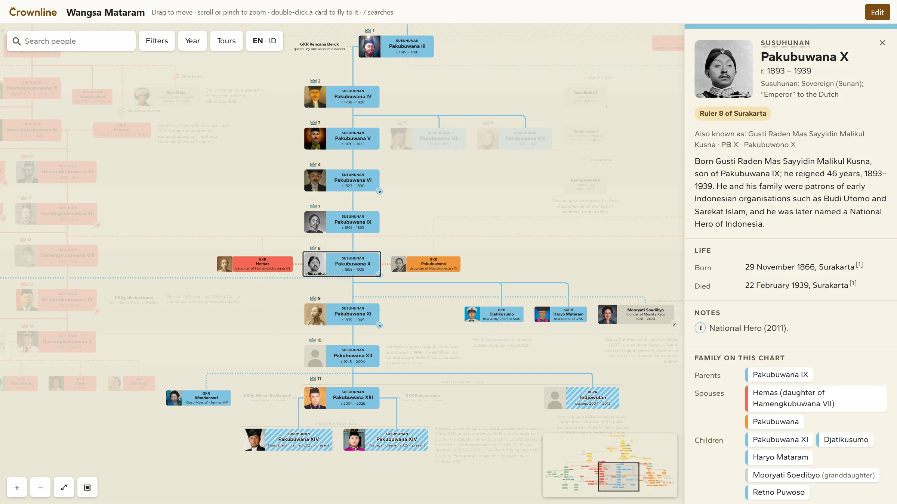
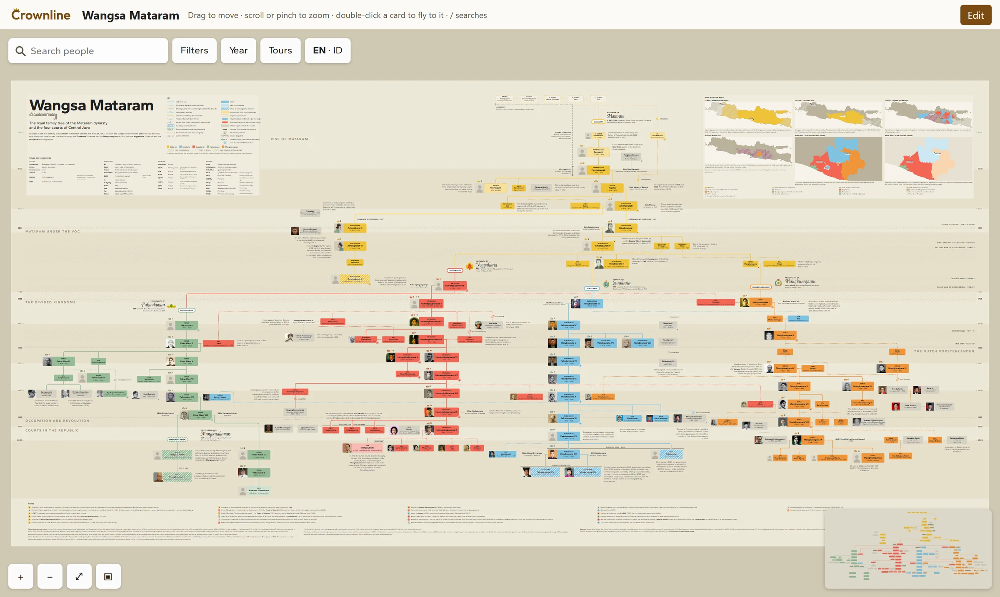
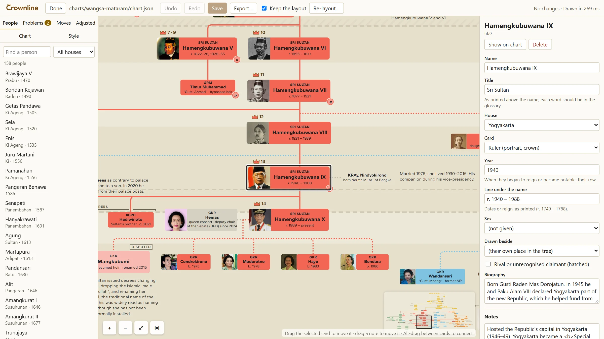

<h1><picture><source media="(prefers-color-scheme: dark)" srcset="docs/images/wordmark-dark.svg"></picture></h1>

**Large royal family-tree charts: drawn for print, explorable on the web, editable in the browser or by a language model.**

**[Try the demo →](https://almer113.github.io/crownline/)** No install needed. It runs in the browser, and your changes stay there.

[](https://almer113.github.io/crownline/)

Crownline draws dynasties the way a printed wall chart does. Each person is a card on a time axis. Lines run from parents to children, and marriage lines join couples. Cards are coloured by house, and notes, eras and a header with the title, key and glossary sit around them. A chart is one JSON document. Crownline lays it out, routes the lines, checks for collisions, and gives you a print-size PNG and PDF, plus an interactive viewer for the web.

It comes with two charts:

- **[Wangsa Mataram](charts/wangsa-mataram/chart.json):** the Mataram dynasty and the four royal houses of Central Java that came out of it (Surakarta, Yogyakarta, the Pakualaman and the Mangkunegaran). It runs from the legendary ancestors in the Babad Tanah Jawi to the present day, with six maps of how the kingdom split. Crownline was built for this chart. Its own notes are in [NOTES.md](charts/wangsa-mataram/NOTES.md).
- **[The Tokugawa Shoguns](charts/tokugawa/chart.json):** the fifteen shoguns of Edo and the heads of the house since 1868.

There is also [the tutorial chart](charts/tutorial/chart.json), a made-up house of nine people that [GETTING_STARTED.md](docs/GETTING_STARTED.md) builds step by step.

## What it does



**Read a chart.** The viewer pans and zooms smoothly over charts of hundreds of people. You can:

- search by any name or spelling;
- click a person to see their biography, birth and death with numbered sources, notes, and family;
- follow a line of descent, or find how two people are related;
- step through the years with the time slider, filter by house, and take a guided tour;
- switch between English and Indonesian.

**Print it.** Every chart builds to a single HTML page, a PNG at twice its size, and a PDF, ready for a wall.

**Edit it.** The editor changes people, marriages, notes, houses, eras, the glossary and portraits. The layout is kept, so an edit moves only what it has to, and the editor shows you what moved. Saves can be undone.

**Hand it to a model.** The `crownline` command line and MCP server let a language model like Claude read a chart and change it through checked operations. Each batch is validated and laid out before it is saved, and it can be undone. See [AI.md](docs/AI.md).

**Publish it safely.** Every portrait and emblem carries its credit and licence. A public build swaps the ones that may not be published for silhouettes or blank space of the same size, so nothing moves.

## How it works

```
chart.json ──► engine ──► laid-out chart ──► HTML · PNG · PDF
   ▲   (people, marriages,    (cards, lines,        └──► viewer (web component)
   │    houses, notes…)        collision check)
   │                                ▲
 editor · command line · MCP ──►  layout.lock.json  (positions kept between edits)
```

- **The chart document** (`charts/<id>/chart.json`) holds the facts: people, marriages and descents, houses, notes, eras, sources, maps, and media with credits. Every field is described in [FORMAT.md](docs/FORMAT.md).
- **The engine** places cards on the time axis, routes the lines, checks for collisions, and draws the chart.
- **The layout lock** (`layout.lock.json`) remembers where everything went, so the next edit does not re-flow the chart.
- **Every change** goes through the same operations, from the editor, the command line or a model, and every change can be undone.

The details, with every option, are in [HOW_IT_WORKS.md](docs/HOW_IT_WORKS.md).

## Set up

You need [Node.js](https://nodejs.org/) 22 with npm. To export a PNG or PDF, you also need Google Chrome or Microsoft Edge.

```bash
git clone https://github.com/Almer113/crownline.git
cd crownline
npm install
npm run dev
```

Then open http://127.0.0.1:5180.

## Use it

### In the browser

The app opens on the library, with a card for each chart in `charts/`.

- **Open** a chart to read it.
- **Edit** opens the editor at the same place.
- **Done** takes you back to the viewer.

The editor saves straight to the chart's `chart.json`. Changes made outside the app, by hand or by a model, appear as soon as they are saved. [EDITOR.md](docs/EDITOR.md) covers every control.



To start a chart of your own, follow [GETTING_STARTED.md](docs/GETTING_STARTED.md). It builds the tutorial chart from nothing and exports it.

### From the command line

```bash
npm run check                                                   # check every chart: schema, references, tree rules
npm run build:chart -- charts/tutorial/chart.json --png --pdf   # draw a chart as HTML, PNG (2x) and PDF
npm run build:chart -- --public                                 # the public builds, without files that may not be published
npm run crownline -- find wangsa-mataram Pakubuwana             # find people in a chart
npm run crownline -- help                                       # every command
```

### With a language model

In [Claude Code](https://claude.com/claude-code), open the repository and ask in your own words. The MCP server and the skill are already declared. For example:

> In the tutorial chart, add Prince Edwin's wife, Lady Isolde of Brackwater, and fix anything it runs into.

For any other MCP client, run the server with `node --import tsx packages/cli/src/main.ts mcp` from the repository. [AI.md](docs/AI.md) has the configuration, and [AI_GUIDE.md](docs/AI_GUIDE.md) is the guide written for the model itself.

## Documentation

| Document | For |
|---|---|
| [GETTING_STARTED.md](docs/GETTING_STARTED.md) | Install, open the app, make a small chart from nothing, export it |
| [EDITOR.md](docs/EDITOR.md) | Every control in the editor |
| [STYLE.md](docs/STYLE.md) | The rules a chart follows: lines, cards, colours, writing, and how to fix a collision |
| [FORMAT.md](docs/FORMAT.md) | Every field of `chart.json` and `layout.lock.json`, made from the schema |
| [AI.md](docs/AI.md) | Editing through a language model: the MCP server, the command line, setup |
| [AI_GUIDE.md](docs/AI_GUIDE.md) | The guide written for the model itself |
| [HOW_IT_WORKS.md](docs/HOW_IT_WORKS.md) | The engine, the layout, the lock, the operations, the build and every option |
| [ASSET_AUDIT.md](docs/ASSET_AUDIT.md) | Which fonts, portraits and marks may be published |
| [CONTRIBUTING.md](CONTRIBUTING.md) | Corrections, new charts and code: the rules and the checks |
| [CHANGELOG.md](CHANGELOG.md) | What changed in each release |

## Status

Version 0.1.0, the first release, came out on 20 November 2026. Changes since then are in the [changelog](CHANGELOG.md). The app is tested in Chrome and in Safari's engine (WebKit). Firefox is not yet checked. The Wangsa Mataram chart is current as of November 2026. Corrections with a source are welcome: see [CONTRIBUTING.md](CONTRIBUTING.md).

## For developers

Crownline is an npm workspace of seven packages:

| Package | What it is |
|---|---|
| `packages/schema` | The chart format: its schema, the check, migrations, the layout lock |
| `packages/engine` | The layout engine: lays a chart out, routes the lines, checks it, draws it, prints PNG and PDF |
| `packages/ops` | The operations every change goes through, with undo |
| `packages/viewer` | `<crownline-viewer>`, the interactive viewer, a web component any page can embed |
| `packages/editor` | The editor, as a library the app loads when you edit |
| `packages/app` | The app: library, view and editor at one address, and its local server |
| `packages/cli` | The `crownline` command line and MCP server |

The original engine, in Python at the repository root, stays as the reference that the TypeScript engine is tested against ([HOW_IT_WORKS.md §20](docs/HOW_IT_WORKS.md#20-the-python-reference-engine)).

The checks, which also run on every push (`.github/workflows/tests.yml`):

```bash
npm run typecheck       # all seven packages
npm run test:schema     # the format and the check
npm run test:port       # the engine against the Python engine and the small test charts
npm test -w @crownline/ops
npm run test:cli
python -m pytest        # the Python engine, the layout lock, assets, font coverage (pip install -r requirements-dev.txt)
ruff check .
```

The viewer has its own: `npm run test:browsers` (Chrome, Firefox and WebKit with Playwright), `npm run test:engine` (the engine's text layout against Chrome's) and `npm run smoke`. `npm run demo` serves the viewer's demo page on its own at http://localhost:5173.

`npm run build:site` builds the demo site in `release/site/`. It contains the whole app as static files, the charts with only the files they may publish, and a picture-credits page. On the site, Save downloads the chart's folder as a .zip. `npm run test:site` tries it in Chrome, WebKit and Firefox.

### Fonts

The charts use open fonts, kept in `assets/fonts/open/` with their SIL Open Font Licences:

- Gantari for all text;
- Felipa for house names;
- Noto Sans Javanese for the aksara Jawa title;
- Noto Sans JP, cut to the characters used, for the Tokugawa chart's Japanese title.

A chart picks its fonts in `theme.fonts`. A public build (`--public`) and the demo site refuse proprietary ones. A different main font changes the widths of the cards, so the layout re-flows: run the layout check afterwards.

### Public and private builds

Some portraits, one emblem and the FANMADECHART logo may not be published (see the [asset audit](docs/ASSET_AUDIT.md)). Their `media` records say so (`private`). A public build swaps them for silhouettes and empty space of the same size, so the layout does not move. This repository is built without them, so its charts draw the same way in every build.

## Licence

- **Code:** MIT, see [LICENSE](LICENSE).
- **Charts and data:** CC BY-SA 4.0, see [LICENSE-CONTENT.md](LICENSE-CONTENT.md).
- **Assets** keep their own licences. Credits for portraits and emblems are in each chart's `media` records and on the demo's credits page. The map data (geoBoundaries, CC BY 3.0 IGO) is credited on the chart.

